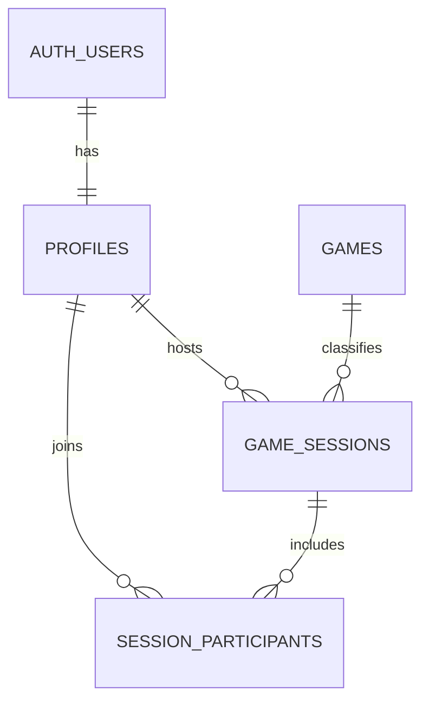

# CONNECT HUB

**Your Campus. Your People. Your Game.**

CONNECT HUB helps college students find teammates for indoor and outdoor games. Students can browse upcoming sessions, host a game, or join a session with room.

## Problem and proposed system

Students often have spare time but no easy way to find available teammates. Informal group chats make game, time, location, and remaining places difficult to see together. Connect Hub puts that information in one campus-focused application.

## Features

- Responsive landing page, indoor and outdoor catalogs, session filters, session creation, and student dashboard.
- Supabase Auth; profile rows are linked one-to-one to auth users.
- Registration stores the student's name, college email, roll number, department, year of study, and username; login uses email and password.
- Express REST API verifies Supabase access tokens for protected operations.
- PostgreSQL constraints, RLS policies, and authenticated functions protect profile ownership, host permissions, duplicate joins, and session capacity.
- Dark and light themes persist in local storage.

Catalog includes Chess, Carrom, Table Tennis, Cricket, Football, Badminton, Volleyball, and Basketball. Predefined campus locations are offered in the session form.

## Architecture

Browser: React + Vite. Authentication: Supabase Auth. API: Express. Data: Supabase PostgreSQL. Express validates the access token and derives the student identity before performing protected operations. An auth.users trigger creates each profile.

## Database design

| Table | Purpose | Keys |
| --- | --- | --- |
| profiles | Student identity and academic details | id references auth.users; email, username, and roll_number unique |
| games | Indoor/outdoor catalog | id primary key; name unique |
| game_sessions | Hosted campus sessions | id primary key; host_id and game_id foreign keys |
| session_participants | Students attending sessions | Composite primary key (session_id, student_id) |

Relationships: one auth user has one profile; one profile hosts many sessions; one game appears in many sessions; students and sessions have a many-to-many relationship through session_participants. The host is inserted as the first participant.

### ER diagram

### Integrity and database operations

- Foreign keys prevent sessions without a valid host/game and participants without a valid student/session.
- Unique constraints prevent duplicate usernames and roll numbers. The participant composite key prevents duplicate joining.
- Database functions lock the session row before counting, preventing concurrent joins from exceeding capacity. Their student identity comes from `auth.uid()` in the verified access token.
- Indexes support upcoming-session, game, and student participation lookups. RLS is enabled on public tables.
- The app uses only the Supabase publishable key. Express verifies each protected request's Supabase access token and creates a user-scoped client, so RLS runs as that student.

## Authentication and session flow

The client registers and signs in with Supabase Auth using email and password. It sends `Authorization: Bearer <access-token>` for protected API calls. Express verifies the token and performs database operations using that same user's identity. It does not trust a user ID sent by the browser.

Creating a session validates its game, campus location, future date, capacity, and note. A PostgreSQL function inserts the session and host participant together. Joining calls a row-locking function to check status, time, membership, and capacity before insertion.

## Run locally

Requirements: Node.js 20 or newer and a Supabase project.

1. Copy `.env.example` to `.env` and set `SUPABASE_URL`, `SUPABASE_PUBLISHABLE_KEY`, `VITE_SUPABASE_URL`, and `VITE_SUPABASE_PUBLISHABLE_KEY`.
2. Apply `database/migrations/001_initial_schema.sql`, `002_student_profile_details.sql`, and `003_email_auth_rls.sql` in order for a new database. The existing CONNECT HUB project already has the profile fields and seed games, so apply only migration 003 there.
4. Install dependencies: npm install, npm --prefix client install, and npm --prefix server install.
5. Start both parts: npm run dev.
6. Open http://localhost:5173. API health: http://localhost:4000/api/health.

The UI renders without credentials, but authentication and database operations require Supabase configuration. Do not commit .env.

For faster development testing, open the Supabase dashboard and go to **Authentication → Sign In / Providers → Email**. Turn **Confirm email** off so registration returns a session immediately. Turn it back on before using real student accounts; when enabled, new students must confirm their email before they can sign in.

## API

GET /api/health, GET /api/games, GET /api/sessions, POST /api/sessions, POST /api/sessions/:id/join, GET /api/profile, PUT /api/profile, GET /api/sessions/created, GET /api/sessions/joined, GET /api/dashboard. Protected routes require a Supabase access token.

## Verification checklist

With Supabase configured, verify registration and duplicate profile constraints, login and protected routes, session creation with host membership, participant counts, full and duplicate join rejection, theme persistence, and desktop/mobile layouts.

## Future enhancements

Password recovery, host session cancellation, richer game imagery, and automated integration tests can extend the demonstrator; these are not currently implemented.

## Public deployment

The repository includes a Render Blueprint (`render.yaml`) for the Vite frontend and Express API. Both services are configured for Render's Free compute plan. A free API can sleep after 15 minutes without traffic, so the first request after a quiet period may take longer. Render also applies monthly usage limits; review its current Free plan limits before deployment.

1. Push this repository to a public GitHub repository.
2. In Render, choose **New → Blueprint**, connect the GitHub repository, and use the included `render.yaml`. Keep both services on **Free**; do not enable paid options.
3. During setup, enter these values in Render's prompts. Do not commit them to GitHub:
   - API service: `SUPABASE_URL`, `SUPABASE_PUBLISHABLE_KEY`, and `CLIENT_ORIGIN` (the final frontend `onrender.com` origin).
   - Frontend service: `VITE_API_URL` (the API URL ending in `/api`), `VITE_SUPABASE_URL`, and `VITE_SUPABASE_PUBLISHABLE_KEY`.
   The Supabase publishable key is intended for browser use with RLS. Never use a Supabase secret or service-role key.
4. In Supabase **Authentication → URL Configuration**, set the deployed frontend URL as the Site URL and add it to the allowed Redirect URLs. Keep the existing project and billing plan.
5. Open the frontend URL and check registration, login, game browsing, and session operations. The API health endpoint is `<API URL>/api/health`.

GitHub Pages alone cannot run this app's Express API. The frontend and API both need deployment, and the deployed frontend must point to the deployed API rather than `localhost`.
